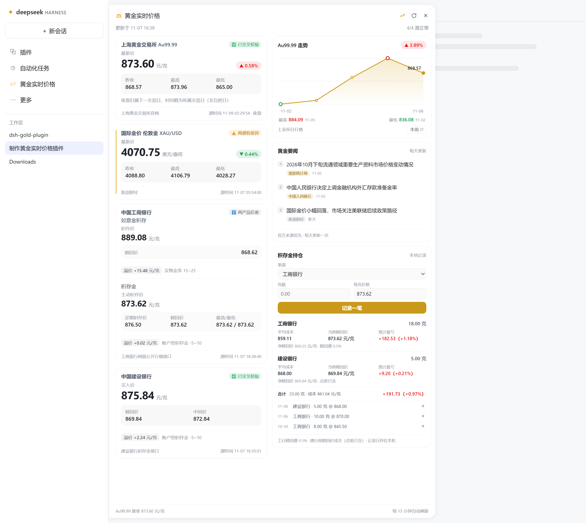
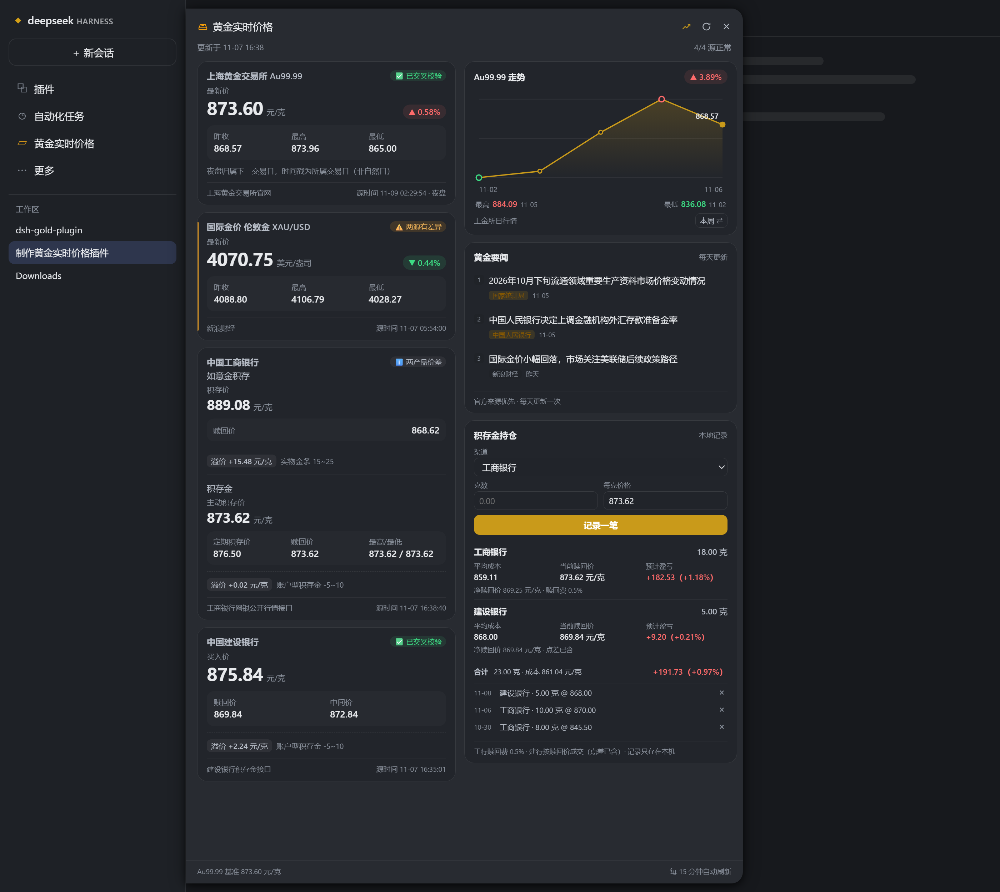

# dsh-gold-card

DSH 黄金实时价格面板插件 —— 在**左侧边栏「自动化任务」正下方**加一行纯文字入口「黄金实时价格」，点开以卡片形式展示四类金价；
面板头部第三个按钮可再展开一列「Au99.99 走势图 + 黄金要闻」，默认隐藏。

- 四个数据源**全部直连官方/权威源**，零第三方依赖（只用 Node 内置 `https`/`zlib`/`crypto`）
- 全部请求免 Key、免登录、无商业付费 API、无无头浏览器、无代理源
- 四源并发抓取，实测 **520~900ms**；Host 侧 60 秒缓存 + 过期回退 + 同源并发去重；面板**每 15 分钟**自动刷新

## 面板长什么样

每张卡片一个主视觉层次：**主价格大数字（26px）+ 涨跌胶囊（▲/▼，涨红跌绿）+ 其余指标统计网格**，
卡片左缘按校验等级上色（绿=已校验 / 琥珀=有差异疑似陈旧 / 灰=单源 / 中性=两产品价差）。
右上角徽标分级更细：`✅ 已交叉校验`、`ℹ️ 两产品价差`、`⚠️ 两源有差异`、`⚠️ 仅单源`、`⚠️ 疑似陈旧快照`，
「差异」不再一律谎报成「陈旧」。暗色主题自适应，面板内容可滚动。

## 侧边栏入口

侧边栏的「面板导航」里会多出一行，位置在 **「自动化任务」正下方、「更多」上方**：

```
插件
自动化任务
黄金实时价格      ← 本插件（纯文字行，与原生行同款：图标 + 文字）
更多
```

- 文案固定为 **黄金实时价格**，行内不塞价格（避免挤压原生行布局）；
  鼠标悬停的 tooltip 里带实时 Au99.99 价格与涨跌幅。
- 尺寸、内边距、圆角、hover、focus 环、折叠成 56px 轨道时的图标形态，
  全部在运行时**复用原生面板行的 CSS Module 类名**，与「插件 / 自动化任务」完全一致。
- 点击展开贴边面板（标题同为「黄金实时价格」），再点或按 Esc 收起。
- 侧边栏被完全收起（抽屉离屏）时，退化为左下角一个金锭图标按钮。

## 截图

| 浅色 | 暗色 |
|---|---|
|  |  |

## 每张卡片长什么样

主价格是大数字（26px）+ 涨跌胶囊（▲/▼，涨红跌绿），其余指标收进统计网格；
卡片左缘按校验等级上色。右上角徽标分级：

| 徽标 | 含义 |
|---|---|
| ✅ 已交叉校验 | 两个独立源给出的价格一致 |
| ℹ️ 两产品价差 | 工行如意金 vs 积存金，本来就不同价，仅作提示 |
| ⚠️ 两源有差异 | 两源超出容差，通常是报价时点不同（**不等于**陈旧） |
| ⚠️ 仅单源 | 校验源不可用，只拿到一个源 |
| ⚠️ 疑似陈旧快照 | 由双重反算 / 变化检测证实的陈旧定价 |


## 四张卡片

| 卡片 | 内容 | 单位 | 数据源 |
|---|---|---|---|
| 上海黄金交易所 Au99.99 | 最新价 / 涨跌幅 / 昨收 / 最高 / 最低 | 元/克 | 上金所官网 `/graph/quotations`（主）+ `/sjzx/yshqbg`（校验）+ `/sjzx/quotation_daily_new`（昨收） |
| 国际金价 伦敦金 XAU/USD | 最新价 / 24h 涨跌 / 昨收 / 最高 / 最低 | 美元/盎司 | 新浪财经 `hq.sinajs.cn/list=hf_XAU`（主）+ gold-api.com（现价兜底） |
| 中国工商银行 | 如意金积存：积存价 / 赎回价；积存金：主动积存价 / 定期积存价 / 赎回价 / 最高最低 | 元/克 | 工行网银公开行情 `POST mybank.icbc.com.cn/servlet/AsynGetDataServlet`（A00505 / A00622） |
| 中国建设银行 | 买入价 / 赎回价 / 中间价 | 元/克 | 建行 `creditcard1.ccb.com` `TXCODE=100119` → `TXCODE=NGJS01` |

每张卡片都显示**数据源自带的报价时间戳**（`delaystr` / `[12]+[6]` / `sysdate` / `Tms`），
不使用本地抓取时刻冒充。

## 右侧：走势图 + 黄金要闻（可选）

面板头部第三个按钮（折线图标）控制一整列的显隐，**默认隐藏**；选择存在
`localStorage['dsh-gold-card:extras']`，下次打开保持。展开后面板加宽到 780px，窄窗口自动上下堆叠。

- **Au99.99 走势**：真实日收盘价折线（东方财富 `118.AU9999` 日 K，主源不可用时自动改用
  上金所日行情兜底，仍为交易所真实收盘价）。右下角小按钮在「本周 / 本月」之间切换，
  切换只重绘、不重新请求。本月不足 8 个交易日时自动显示近 22 个交易日，
  避免月初「本月」和「本周」长得一模一样。
- **黄金要闻**：北京时间每天只抓一次，按「官方优先 → 话题权重 → 发布时间」排序取前 3 条。
  官方源：中国人民银行、国家统计局、上海黄金交易所、美联储（FOMC 声明 / 会议纪要）；
  媒体源：新浪财经贵金属。每条都带标题、来源和时间，点击新窗口打开原文。
  当天没有新内容时保留原来的 3 条并标注「今日暂无新增资讯」，不会清空。

> 资讯为原站内容的标题与链接聚合，版权归原站；只作信息参考，不构成投资建议。

## 积存金持仓（本地记录）

右侧列底部还有一个「积存金持仓」模块，用来记自己每一笔积存、并估算**全部赎回**的盈亏：

- 每笔记录：渠道（工商银行 / 建设银行）、克数、成交时每克价格；填完点「记录一笔」。
  渠道下拉切换时，「每克价格」会自动填该渠道当前报价，可手动改。
- 汇总（分渠道 + 合计）：持仓克数、平均成本（按克数加权）、当前赎回价、预计盈亏（元 / %）。
- 盈亏按渠道规则算：
  - **工商银行积存金**：赎回按赎回价成交，另收赎回金额 **0.5%** 手续费，所以净赎回价 = 赎回价 × 0.995；
  - **建设银行积存金**：买卖点差已体现在买入价 / 赎回价里，赎回不再另收手续费。
  两个渠道的赎回价都直接取面板里的实时报价，行情刷新时盈亏跟着变。
- 记录只存在浏览器 `localStorage['dsh-gold-card:positions']`，不上传、不同步；每条记录可单独删除。
- 这个模块属于右侧列，需要点头部折线按钮展开右侧列后才显示。
- 计算口径是「按当前赎回价一次性全部赎回」的估算，不含大额赎回限制、到账时间、税费等；仅供参考，不构成投资建议。

## 安装

### 方式一：从 GitHub 安装（推荐）

```bash
git clone https://github.com/ZCX26324/dsh-gold-card.git
```

然后在 DSH 里让 Agent 执行（或在插件管理器中）：

```text
plugin_manager install_bundle(target = "link:<克隆下来的目录绝对路径>")
```

### 方式二：CLI

```bash
dsh plugin --profile desktop add link:<本目录绝对路径>
```

### 装好后

- Host 半边（路由 + 数据抓取）**即时生效**，不用重启 DSH。
- 侧边栏入口：**刷新一次页面**（Ctrl+R / 重开窗口）就会出现；老版本桌面壳如果刷新后仍没有，
  重启一次 DSH 即可（桌面壳在启动时取 index 注入表快照）。
- 面板资源每次请求都从磁盘读（`cache-control: no-store`），改面板只需刷新页面。

### 方式三：从 DSH 插件市场安装

仓库自带一份 [插件市场索引](market/index.json)（DSH 索引格式 1）。在 DSH 里：

1. 侧边栏 **设置 → 插件 → 发现（Discover） → 索引源（Index sources） → 添加**
2. 粘贴：

   ```text
   https://raw.githubusercontent.com/ZCX26324/dsh-gold-card/main/market/index.json
   ```

3. 「发现」页就会出现「黄金实时价格」，点**安装**即可。

索引把版本固定在某个 commit 上（`source.commit`），所以市场里看到的版本和源码一致。
新增版本时用 `node tools/market-index.cjs --commit <40 位 SHA>` 重新生成并校验。

> DSH 自带的「发现」页默认没有任何索引源，需要先添加；这是官方设计（索引源由用户配置）。

## 验证

```bash
npm test            # 五段全跑（含真实四源连通）
npm run test:apply  # 用 mock ctx 校验路由 / index 注入（离线）
npm run test:market # 走势 K 线 / 要闻解析与日更缓存单测（离线）
npm run test:panel  # 用极小 DOM stub 真正跑 panel.js，校验渲染/交互（离线）
npm run test:parse  # 上金所分时解析单元测试（离线）
npm run test:sources# 真实四源连通性 + 关键解析断言
```

`npm test` 期望输出：离线四段各自 `全部通过 ✅`，四源 `4/4 源成功`。
离线四段在 CI（`.github/workflows/test.yml`）里随 push / PR 自动跑；四源冒烟需要外网，
只在本地手动跑。

安装后不打开浏览器也能确认插件活着（路由用 `resource` 注册，可在进程内自检）：

```bash
# Windows
type %USERPROFILE%\.dsh\.dsh-gold-card.log
```

日志里应看到：

```
apply: start build=xxxxxxxx pid=... DSH_HOME=... refreshMs=900000
index-inject listener registered
route registered: /dsh-gold/panel.js
...
index-inject verify: rows=N ours=1 placement=body len=670     # 注入表里确实有自举行
selfcheck assets {...}（全部可服务）
selfcheck quotes status=200 base={"base":868.6,...}
panel mounted proto=... href=...                              # 页面里 panel.js 真的挂载成功
```

服务端点（Host 进程内）：

| 路由 | 说明 |
|---|---|
| `GET /dsh-gold/api/quotes` | 四类金价 JSON（契约见 `CONTRACT.md` 第 3 节） |
| `GET /dsh-gold/api/extras` | 走势（本周/本月）+ 黄金要闻（契约见 `CONTRACT.md` 第 3.5 节） |
| `GET /dsh-gold/api/status` | 插件自述：build、路由列表、注入表自检、面板挂载报告 |
| `GET /dsh-gold/api/mounted` | 面板挂载自报（panel.js 打开时请求一次，写日志） |
| `GET /dsh-gold/api/diag` | 前端挂载诊断：把真实 DOM 现场（frame/nav/行文案/入口父节点）写进日志 |
| `GET /dsh-gold/panel.js` / `.css` | 面板静态资源 |

## ⚠️ 关键实现约束：TLS 旧式重协商

工行与建行的服务器仍使用 **unsafe legacy renegotiation**，OpenSSL 3.x / Node 18+ 默认拒绝，
报错 `EPROTO ... unsafe legacy renegotiation disabled`（**极具误导性，看起来像网络故障**）。

```js
const crypto = require('node:crypto')
https.request(url, { secureOptions: crypto.constants.SSL_OP_LEGACY_SERVER_CONNECT })
```

不加上这行，工行与建行两个源会**同时失败**。证书链校验仍然保留（`rejectUnauthorized: true`）。

## 校验规则（提示词 v3 第五、六节）

- **溢价带按标的类型分**：账户型积存金 `[-5, +10]` 元/克；实物金条（如意金）`[+15, +25]` 元/克。
  用同一条带会把最准的两个直连源误判为「陈旧快照」。
- **双重反算**：用「上一交易日收盘」与「当前 Au99.99」分别反算溢价。
  只有「旧基准能解释报价、现价不能解释报价」才判为按旧基准定价的陈旧快照（`crossCheck=stale`）；
  当日金价波动大于带宽时按昨收反算必然越界，那属正常新报价，不判陈旧。
- **交叉校验**：上金所 A/B（容差 1.0 元/克）、新浪 vs 建行 `Acrs_Spot`（容差 3 美元/盎司）、
  工行 A00622 vs A00505 赎回价（容差 3 元/克）、建行用国际金价反算隐含溢价带。
  徽标五级：`✅ 已交叉校验` / `ℹ️ 两产品价差` / `⚠️ 两源有差异` / `⚠️ 仅单源` / `⚠️ 疑似陈旧快照`；
  「两源有差异」只说明报价时点不同，只有双重反算 / 变化检测证实的才升级为「疑似陈旧」。
- **昨收口径**：日盘用上一交易日收盘；20:00 后夜盘归属下一交易日，昨收取**当天日盘收盘**，
  否则涨跌幅会错算成两天前。
- **时效校验**：源时间戳距当前 > 6 小时且处于交易时段 → 「非实时报价」。
- **变化检测**：某源连续两次抓取完全一致、而同期 Au99.99 有变动 → 标记疑似未刷新。
- **失败降级**：单源失败不影响其它卡片；请求失败回退上一次成功数据并标注「数据可能滞后」；
  金融看板宁可显示旧值，也不要空卡片。

## 目录

```
lib/
  index.cjs    Host 半边：webServer.register(resource) 路由 + index-inject 自举脚本 + 进程内自检
  gold.cjs     聚合层：60s 缓存、并发去重、过期回退、交叉校验、时效校验、双重反算、变化检测
  sources.cjs  通用请求层（连接/读取分离超时、重定向、gzip、GBK、Cookie jar、错误归一）
               + 工行 / 建行 / 新浪 / gold-api 数据源
  sge.cjs      上金所三个接口（含昨收 -> 涨跌幅）+ 历史日行情回溯（走势兜底），带 www/apex 域名回退
  market.cjs   走势：东方财富日 K 解析、本周/本月窗口、30 分钟缓存、上金所兜底
  news.cjs     要闻：5 个官方/媒体源解析、排序去重、日更缓存与回退
assets/
  panel.js     前端面板：侧边栏入口 + 贴边面板 + 四卡片（hero/涨跌胶囊/统计网格）+ 右列走势/要闻 + 15 分钟刷新 + 折叠态退化
  panel.css    面板样式（只吃 DSH 主题变量，亮/暗色自适应、细滚动条）
test/
  apply-smoke.cjs  mock ctx 校验路由与 index 注入
  market-parse.cjs 走势窗口 / 资讯解析 / 排序去重 / 日更缓存单测
  panel-dom.cjs    极小 DOM stub 真正跑 panel.js，校验渲染/交互/降级/右列显隐
  sge-parse.cjs    上金所分时解析单元测试（占位尾段 / 周末墙钟 / min-max 不一致 / 交易日时间轴）
  smoke.cjs        真实四源连通性 + 解析陷阱断言
tools/
  asar-probe.cjs   读 app.asar 的排查工具（list / grep / cat），维护时查 DSH 内部 API 用
  preview.cjs      离线 UI 预览：vm 跑 panel.js + panel.css 生成同构 HTML（含右列走势/要闻 mock），支持 --live 抓真实数据
  market-index.cjs 生成 / 校验插件市场索引（用官方 @deepseek-ai/dsh-plugin-market-index 校验）
market/
  index.json       插件市场索引（DSH 索引格式 1），在「发现 → 索引源」里添加即可安装
docs/images/       面板截图（README 用）
CONTRACT.md      Host / 数据层 / 前端三方接口契约
```

## 排查

- **上金所「最新价」怎么取？**（2026-11-07 实测踩到的两个坑）
  1. 分时序列覆盖 20:00~次日 15:30，但**尚未发生的时点会被同一个值填满**
     （实测日盘 391 个点全是 863）。所以不能取「data 最后一个有效值」——那会拿到占位值，
     让最新价比真实值低十几元。做法：**先截掉「连续 ≥20 个相同值」的占位尾段**，
     再用源站的 `now`（墙钟）在交易日时间轴上收敛到「最后一个已走到的时点」。
     只靠 `now` 不够：2026-11-07 是周六，但 15:07 落在日盘时间窗内，会把周一的日盘
     占位值误当成已发生时点（当日 `delaystr` 仍停在 `11月09日 02:29:54`，日盘其实没开）。
     `test/sge-parse.cjs` 用固定序列覆盖了这两个陷阱。
  2. 接口自报的 `min`/`max` 可能与序列不一致（实测 865/873 vs 序列 865~873.96）。
     高低价一律由**已走时点**的序列自己算，保证「最低 ≤ 最新 ≤ 最高」。
  3. 时间戳是**交易日口径**：夜盘（20:00~次日 02:30）归属**下一交易日**，所以日期可能大于自然日。
     例如周五夜盘显示 `2026年11月09日 02:29:54`（下周一交易日），官网页面也是同样的标注。
     卡片会显示「· 夜盘」并附一行口径说明。
  4. 接口 B（`/sjzx/yshqbg` 延时行情表）是**日盘**口径，日盘未开时它比 A 旧；
     两者差异超出容差时徽标显示「⚠️ 仅单源」并写明口径差异（不再误判成「陈旧快照」）。
- **入口没出现在「自动化任务」下方**：先看 `.dsh-gold-card.log` 里的 `diag {…}` 行，
  它会给出真实 DOM 中 `frame / nav / 行文案 / 入口父节点 / mode`。
  面板探测是三级兜底：① 按 `<nav>` 里「插件 / 自动化任务」文案打分 →
  ② 全文档找文案为「自动化任务」的按钮（穿过 Tooltip 包裹层）→ ③ `[data-window-drag]` 找 SidebarRoot。
  三级都失败才会退化到左下角轨道按钮，并上报 `diag reason=no-sidebar`。
  注意：可见性判断用的是 `<nav>` / SidebarRoot 自己的矩形，**不是** `root.parentElement`
  （实测它是零宽包装层，会把入口误判成不可见）。
- **某张卡片报错**：卡片会显示归一后的原因（`请求超时` / `连接被拒` / `页面结构变更` /
  `接口返回失败` / `TLS 协商失败（附原始错误码）`）。
- **工行/建行同时失败**：99% 是漏了 `secureOptions: SSL_OP_LEGACY_SERVER_CONNECT`。
- **上金所涨跌幅显示「—」**：昨收接口 `/sjzx/quotation_daily_new` 维护中；最新价不受影响。
